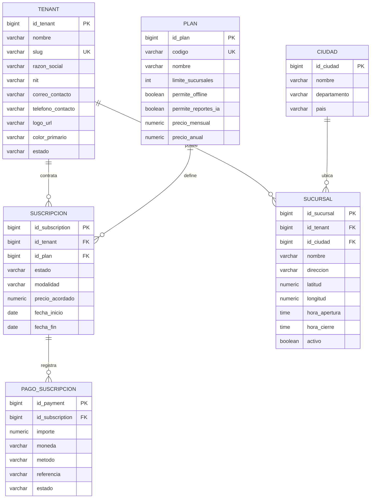
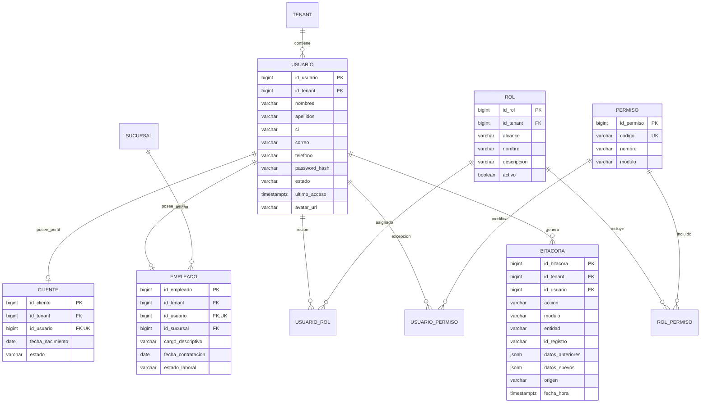
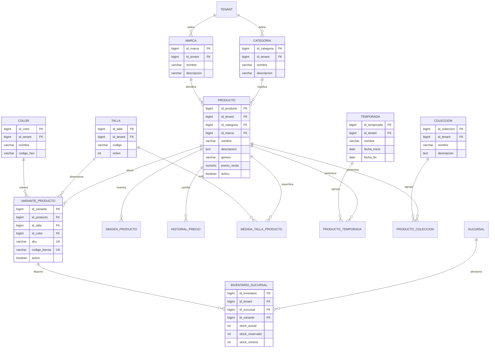
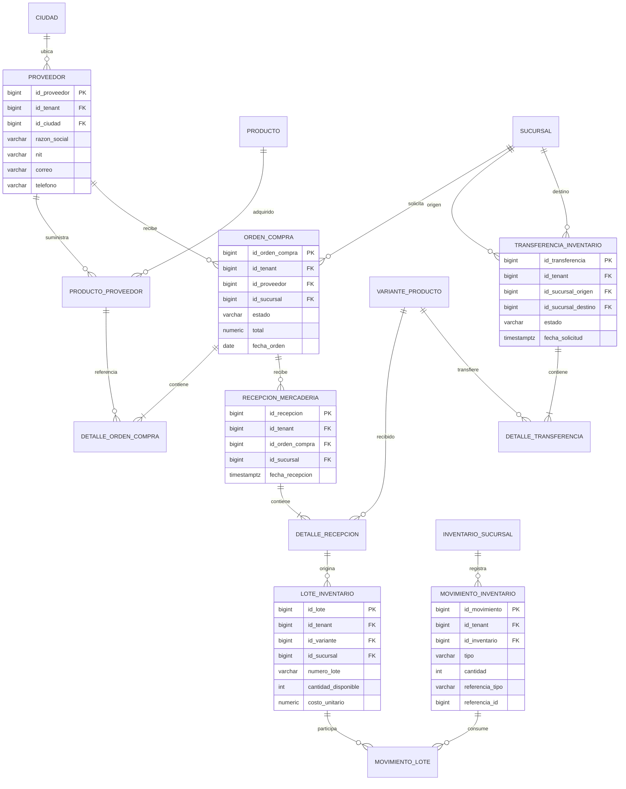
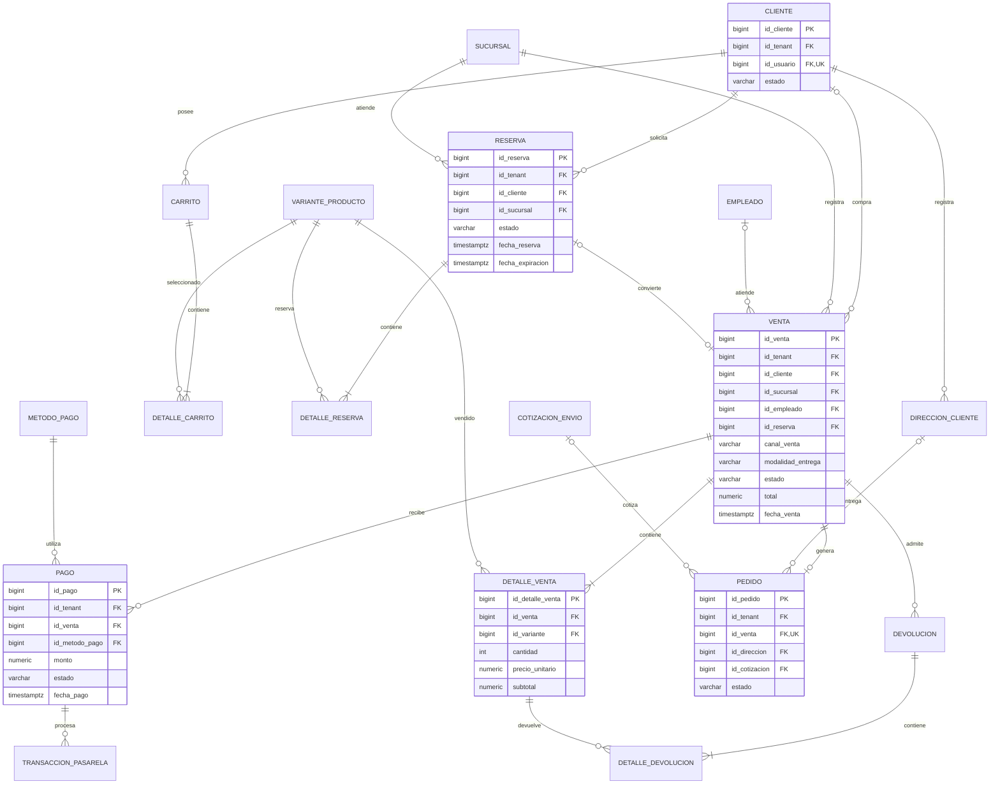
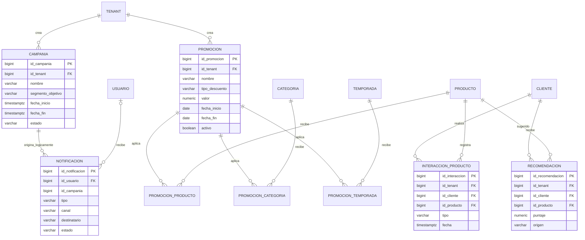
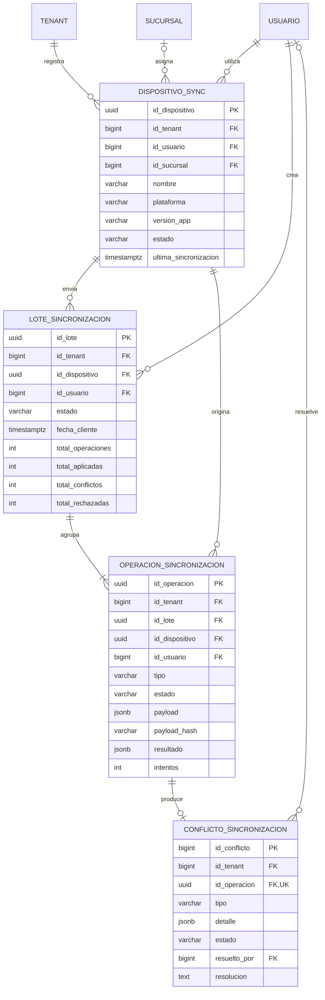

# Modelo de datos de Zentry

Este documento resume el modelo actualmente implementado en SQLAlchemy/PostgreSQL. Para que sea legible, el diagrama se divide por módulos. Todas las entidades comerciales pertenecen directa o indirectamente a un `tenant`.

## Notación de cardinalidades

| Símbolo | Significado |
|---|---|
| `||` | exactamente uno |
| `o|` | cero o uno |
| `|{` | uno o muchos |
| `o{` | cero o muchos |

## 1. Plataforma multitenant

## 2. Identidad, clientes, empleados y seguridad

`USUARIO_ROL`, `ROL_PERMISO` y `USUARIO_PERMISO` son entidades asociativas que resuelven relaciones muchos-a-muchos. El perfil `CLIENTE` y el perfil `EMPLEADO` son opcionales, pero cada uno solo puede existir una vez por usuario.

## 3. Catálogo e inventario disponible

La disponibilidad real se calcula como `stock_actual - stock_reservado`. La combinación sucursal-variante representa una existencia independiente.

## 4. Compras, proveedores y trazabilidad

## 5. Venta, reserva, pago y entrega

Una venta puede ser presencial y no identificar a un cliente; por eso `id_cliente` es opcional. Una venta genera como máximo un pedido porque `pedido.id_venta` es único.

## 6. Marketing y recomendaciones

Nota: `notificacion.id_campania` representa una relación lógica usada por la aplicación, pero actualmente no está declarada como clave foránea física en el modelo. Conviene incorporarla en una migración futura.

## 7. Sincronización offline

El UUID identifica la operación creada sin conexión y `payload_hash` ayuda a garantizar idempotencia. Una operación puede producir como máximo un conflicto.

## 8. Reglas cardinales del sistema

1. Un tenant posee muchas sucursales, pero una sucursal pertenece a un tenant.
2. Un tenant posee muchos clientes; un cliente pertenece a un solo tenant.
3. Un usuario puede tener cero o un perfil cliente y cero o un perfil empleado.
4. Un producto posee una o muchas variantes; una variante pertenece a un producto.
5. Una variante puede existir en muchas sucursales mediante `inventario_sucursal`.
6. Una venta pertenece a una sucursal y contiene uno o muchos detalles.
7. Una venta puede no identificar cliente, por ejemplo una venta de mostrador.
8. Una venta puede recibir varios registros de pago, pero solo puede generar un pedido.
9. Un lote de sincronización contiene una o muchas operaciones.
10. Cada consulta comercial debe quedar limitada por tenant y, cuando corresponda, por sucursal.

## 9. Entidades asociativas principales

| Entidad | Relación que resuelve | Atributos clave |
|---|---|---|
| `usuario_rol` | Usuario N:M Rol | `id_usuario_rol`, `id_usuario`, `id_rol` |
| `rol_permiso` | Rol N:M Permiso | `id_rol_permiso`, `id_rol`, `id_permiso` |
| `usuario_permiso` | Usuario N:M Permiso | `id_usuario_permiso`, `id_usuario`, `id_permiso`, `permitido` |
| `producto_temporada` | Producto N:M Temporada | `id_producto`, `id_temporada` |
| `producto_coleccion` | Producto N:M Colección | `id_producto`, `id_coleccion` |
| `producto_proveedor` | Producto N:M Proveedor | `id_producto_proveedor`, `id_producto`, `id_proveedor`, `costo_referencia` |
| `movimiento_lote` | Movimiento N:M Lote | `id_movimiento_lote`, `id_movimiento`, `id_lote`, `cantidad` |
| `promocion_producto` | Promoción N:M Producto | `id_promocion`, `id_producto` |
| `promocion_categoria` | Promoción N:M Categoría | `id_promocion`, `id_categoria` |
| `promocion_temporada` | Promoción N:M Temporada | `id_promocion`, `id_temporada` |

## 10. Recomendación para presentar el diagrama

No conviene colocar las más de sesenta tablas en una sola hoja: quedará ilegible. Para la defensa se recomienda entregar:

1. diagrama general de plataforma y multitenencia;
2. diagrama de identidad y organización;
3. diagrama de catálogo, compras e inventario;
4. diagrama de venta, pagos y pedidos;
5. diagrama de sincronización offline;
6. archivo `zentry_schema.sql` generado sin datos como respaldo técnico.

Los bloques Mermaid de este documento pueden pegarse en Mermaid Live, draw.io o una herramienta compatible para exportarlos como PNG/PDF.

## 11. Inventario completo de entidades implementadas

El modelo actual contiene **68 entidades físicas**. Esta lista sirve como control para comprobar que el diagrama y el respaldo de esquema corresponden a la misma versión:

| Módulo | Entidades |
|---|---|
| Plataforma | `tenant`, `plan`, `subscription`, `subscription_payment` |
| Identidad y organización | `ciudad`, `sucursal`, `usuario`, `cliente`, `empleado`, `rol`, `permiso`, `usuario_rol`, `rol_permiso`, `usuario_permiso`, `bitacora` |
| Catálogo | `categoria`, `marca`, `talla`, `color`, `temporada`, `coleccion`, `producto`, `variante_producto`, `producto_temporada`, `producto_coleccion`, `medida_talla_producto`, `imagen_producto`, `historial_precio` |
| Compras e inventario | `proveedor`, `producto_proveedor`, `orden_compra`, `detalle_orden_compra`, `recepcion_mercaderia`, `detalle_recepcion`, `lote_inventario`, `inventario_sucursal`, `movimiento_inventario`, `movimiento_lote`, `transferencia_inventario`, `detalle_transferencia` |
| Comercio | `direccion_cliente`, `carrito`, `detalle_carrito`, `reserva`, `detalle_reserva`, `venta`, `detalle_venta`, `metodo_pago`, `pago`, `transaccion_pasarela`, `tarifa_envio`, `cotizacion_envio`, `pedido`, `devolucion`, `detalle_devolucion` |
| Marketing y recomendación | `campania`, `notificacion`, `promocion`, `promocion_producto`, `promocion_categoria`, `promocion_temporada`, `configuracion_recomendador`, `interaccion_producto`, `recomendacion` |
| Sincronización | `dispositivo_sync`, `lote_sincronizacion`, `operacion_sincronizacion`, `conflicto_sincronizacion` |

Los atributos completos —incluidos tipos, nulabilidad, valores por defecto, índices y restricciones— deben tomarse del archivo `zentry_schema.sql`. Este documento prioriza claves y atributos de negocio para que el DER permanezca legible.
